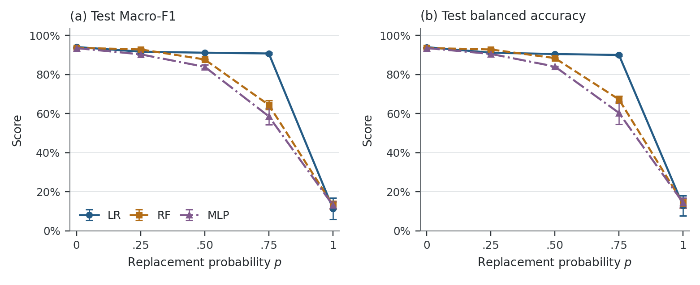

# Label Noise & Generalization

**Memorization and Generalization under Training-Label Randomization on Tabular Data**

**ECS 171 · UC Davis · Group 8** — Tianying Chen, Linjie Yang, Elsey Chen

[](LICENSE)
[](https://creativecommons.org/licenses/by/4.0/)

Zhang et al. (ICLR 2017) showed that deep networks can fit completely random labels, so a low training error says little about generalization. We ask the same question on tabular data: when training labels on the UCI Dry Bean dataset are progressively randomized, how do logistic regression (LR), a random forest (RF), and a multilayer perceptron (MLP) behave on the training labels they were given, and on clean labels they have never seen?

**[Live demo](https://ecs171-label-demo.vercel.app)** · **[Report (PDF)](paper/ECS171_Final_Report.pdf)** · **[Reproduction guide](REPRODUCIBILITY.md)**



## Main result

| Model | Clean-label test Macro-F1 | Training accuracy on fully random labels | Test Macro-F1 after fully random labels |
|---|---:|---:|---:|
| Logistic regression | 0.9404 ± 0.0000 | 0.1602 | 0.1144 |
| Random forest | 0.9361 ± 0.0012 | **1.0000** | 0.1314 |
| MLP (128-64, 500 epochs) | 0.9346 ± 0.0040 | 0.3806 | 0.1309 |

Mean ± sample SD over three paired seeds on one fixed split. The random forest reproduces fully random training labels perfectly while its clean-test score collapses, which is the gap between fitting and generalizing that Zhang et al. describe. At `p = 0.75`, LR still reaches 0.9073 Macro-F1, compared with 0.6440 for RF and 0.5856 for MLP.

A post-holdout exploratory follow-up (`exploratory/`, `results/exploratory/`) adds random-forest out-of-bag accuracy and the predeclared 18-fit MLP capacity study; see Section V-E of the report.

## Quick start

Python 3.12 is required. On macOS or Linux:

```bash
git clone https://github.com/Felix-Yang-369/Label-Noise-Generalization
cd Label-Noise-Generalization
python3.12 -m venv .venv && . .venv/bin/activate
pip install -r requirements.lock.txt
```

Read the recorded results without running anything: [run-level metrics](results/test_metrics.csv), [15 condition summaries](results/model_noise_summary.csv), [tuning candidates](results/tuning.csv), [final evaluation receipt](results/FINAL_EVALUATION.json).

Regenerate the paper figures from the recorded results (no model fitting):

```bash
python paper/tools/build_figures.py --recorded-sources
```

Run the whole experiment again (about 8 minutes of CPU fitting time) in a **fresh copy** of the repository, so new outputs are never mixed with the recorded ones. [REPRODUCIBILITY.md](REPRODUCIBILITY.md) lists the exact files to copy; on Windows, `.\Reproduce.ps1` does this automatically.

```bash
python -m src.pipeline all
python -m pytest -q
python -m app --port 5172
```

## Experimental design

- **Data:** 13,611 raw observations; 68 exact duplicates removed before splitting; 13,543 retained; 16 numerical features; 7 classes. Source column names `AspectRation` and `roundness` are kept as published.
- **Split:** stratified 8,125 / 2,709 / 2,709 (train / validation / test), seeds 171 and 172, identical for every condition.
- **Label randomization:** with probability `p`, a training label is replaced by a uniform draw from all seven classes (the corruption scheme of Zhang et al.). The draw can return the original class, so the expected fraction of changed labels is `6p/7`. For each seed the same random draws are reused across `p`, and every model receives the same label vector. Validation and test labels are never changed.
- **Models:** LR (`C = 1`), RF (200 trees, unlimited depth, leaf size 1), MLP (16-128-64-7, `alpha = 0.01`, Adam, 500 epochs). Settings were chosen from ten clean-label candidates by validation Macro-F1 and then frozen.
- **Main matrix:** 3 models × `p ∈ {0, 0.25, 0.5, 0.75, 1}` × seeds `{17, 29, 43}` = 45 fits, evaluated once on the clean test set after the matrix was complete.
- **Metrics:** clean-test Macro-F1 (primary), accuracy, balanced accuracy, training accuracy against both the supplied and the original labels, convergence, and fit time.

## Repository layout

| Path | Contents |
|---|---|
| `src/` | Data audit, splitting, label noise, models, metrics, and the staged pipeline |
| `app/` | Flask inference service and browser interface |
| `tests/` | Protocol, execution, results-acceptance, and HTTP tests |
| `exploratory/` | Post-holdout analyses (RF out-of-bag accuracy, MLP capacity study) |
| `config/` | Protocol, run matrix, selected parameters, and freeze record |
| `data/raw/` | Unmodified UCI Dry Bean archive and spreadsheet |
| `results/` | Recorded metrics, per-class reports, and the final evaluation receipt |
| `reports/` | EDA and experiment figures, demo verification, demo runbook |
| `docs/` | Reproduction and deployment verification records |
| `paper/` | IEEE-format report source, figures, and figure-building script |

Trained models, processed splits, noise files, and row-level test predictions are generated by the pipeline and are not tracked (see `.gitignore`).

## Demo

The [online demo](https://ecs171-label-demo.vercel.app) loads six saved seed-17 pipelines (LR, RF, MLP trained at `p = 0` and `p = 1`). Pick a model, load a validation example, and compare the clean-label and random-label predictions. Probabilities are raw model outputs, not calibrated confidence. The demo only performs inference. Verification details are in [reports/Web_Verification.md](reports/Web_Verification.md) and [docs/Deployment_Verification.json](docs/Deployment_Verification.json).

## License

This repository contains material under different licenses:

| Material | License |
|---|---|
| Original source code: `src/`, `app/`, `tests/`, `exploratory/`, `paper/tools/`, and the `*.ps1` scripts | [Apache License 2.0](LICENSE) |
| `data/raw/` (UCI Dry Bean dataset) and data derived from it | [CC BY 4.0](https://creativecommons.org/licenses/by/4.0/), with attribution to the UCI Machine Learning Repository and Koklu & Ozkan (2020) |
| `paper/IEEEtran.cls`, `paper/IEEEtran.bst` | LaTeX Project Public License 1.3, as stated in each file |
| Report text, figures, and PDF in `paper/` | © 2026 the authors; all rights reserved except reading, citation, and course assessment |

The Apache License 2.0 applies only to the original code that the authors have the right to license. It does not cover the dataset, the report, or third-party files. See [NOTICE](NOTICE) for full attribution.

## Citation

If you use this code, please cite the dataset and the paper that motivated this study:

1. C. Zhang, S. Bengio, M. Hardt, B. Recht, and O. Vinyals, "Understanding deep learning requires rethinking generalization," in *Proc. ICLR*, 2017. [arXiv:1611.03530](https://arxiv.org/abs/1611.03530v2)
2. *Dry Bean* [Dataset], UCI Machine Learning Repository, 2020. [doi:10.24432/C50S4B](https://doi.org/10.24432/C50S4B)
3. M. Koklu and I. A. Ozkan, "Multiclass classification of dry beans using computer vision and machine learning techniques," *Computers and Electronics in Agriculture*, vol. 174, 105507, 2020.
