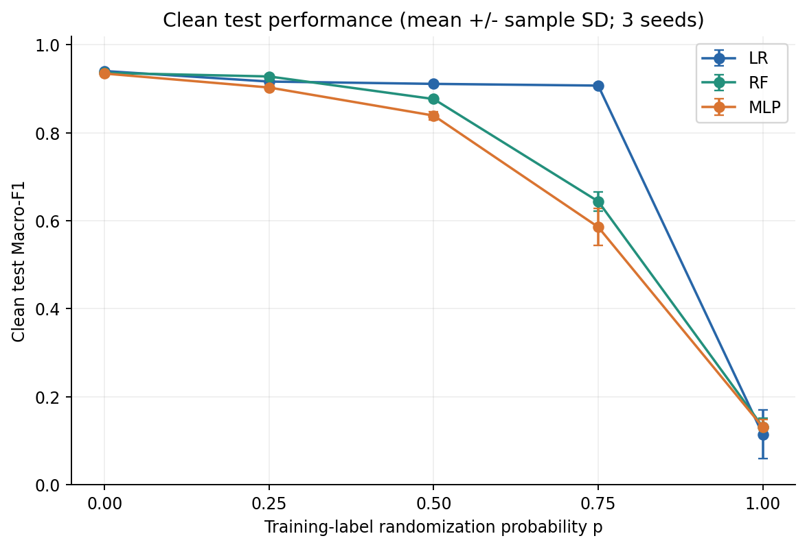
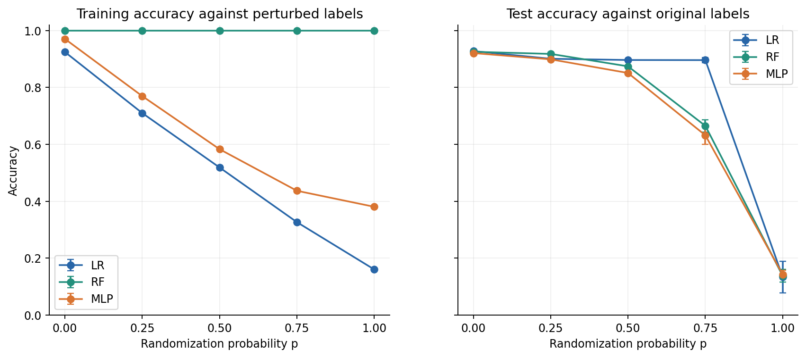
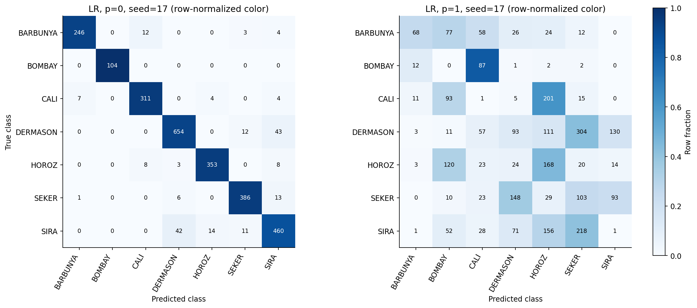
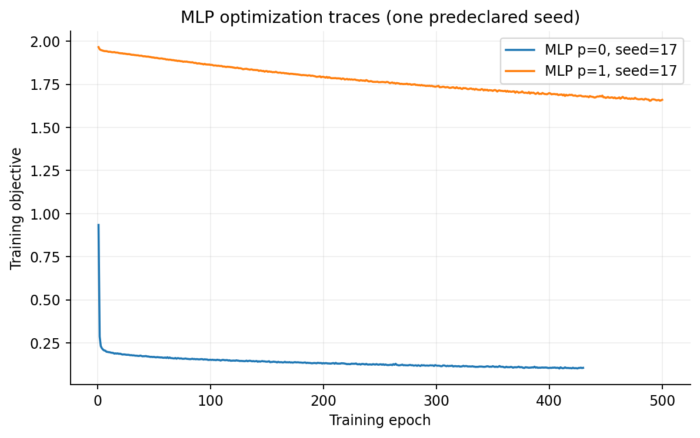

# ECS171 实验结果报告

本阶段已完成独立环境、数据处理、训练集 EDA、10 次干净标签调参、45 次主实验与冻结后的真实标签留出测试。

数据：13,611 原始行，精确去重 68 行后 13,543 行。固定 train / validation / test = 8,125 / 2,709 / 2,709；16 个原始数值特征保留。

调参只使用干净验证集 Macro-F1；各模型配置在噪声主实验前冻结。五档 p 为重新抽标签的选择概率，实际标签改变率 q 另行记录。

三个种子的均值和样本标准差描述标签扰动与模型随机性的联合变化；固定同一数据划分，不能当作多划分稳定性或统计显著性证据。

LR：p=0 的真实测试 Macro-F1 为 0.9404 ± 0.0000；p=1 时为 0.1144。p=1 对扰动训练标签的准确率为 0.1602。

RF：p=0 的真实测试 Macro-F1 为 0.9361 ± 0.0012；p=1 时为 0.1314。p=1 对扰动训练标签的准确率为 1.0000。

MLP：p=0 的真实测试 Macro-F1 为 0.9346 ± 0.0040；p=1 时为 0.1309。p=1 对扰动训练标签的准确率为 0.3806。

观察：在 p=0.75 条件，LR / RF / MLP 的真实测试 Macro-F1 分别为 0.9073 / 0.6440 / 0.5856。这支持当前配置下模型对标签扰动的反应不同，不证明某个架构普遍最优。

观察：RF 在 p=1 完整拟合了随机训练标签，却没有保持干净标签测试表现；这是本实验中记忆能力和泛化表现分离的直接证据。当前 MLP 未完美拟合随机标签，必须连同容量、正则化和训练预算解释。

p=0 的 LR 三次结果完全相同，SD=0；此条件标签相同且 lbfgs 为确定性优化，三个种子并没有产生三个独立划分。

多数类参照由干净训练集选取 DERMASON，其测试 Accuracy 为 0.2617。1/7 只表示独立均匀随机预测的期望 Accuracy，并非所有随机标签模型的必然表现。

55 次研究 fit 的纯训练时间合计 462.8 秒；不包含环境安装、读取、保存、推理和图表时间。14 / 45 个主 run 有收敛相关警告，详细见 CSV 和每个 meta.json。

训练对扰动标签的分数与干净测试分数对应不同目标，图中的差值不命名为标准泛化差距。clean_target_gap 使用原标签训练准确率减去原标签测试准确率。

结果仅限此数据集、固定 split、当前参数与训练预算。若 MLP 未完美拟合随机标签，不能由此否定原论文；其容量、优化和正则化设置不同。18 次可选容量扩展未运行。

代码与模型均在本地保存；本次不包括实时推理网页部署或课程提交。

## 文件入口

- ../../results/test_metrics.csv：45 次完整指标
- ../../results/model_noise_summary.csv：15 个条件的均值与 SD
- ../../results/tuning.csv：10 个候选验证结果
- ../../config/FROZEN.json：测试前冻结证据
- ../../artifacts/runs/：每次模型、日志、训练及验证逐行预测

